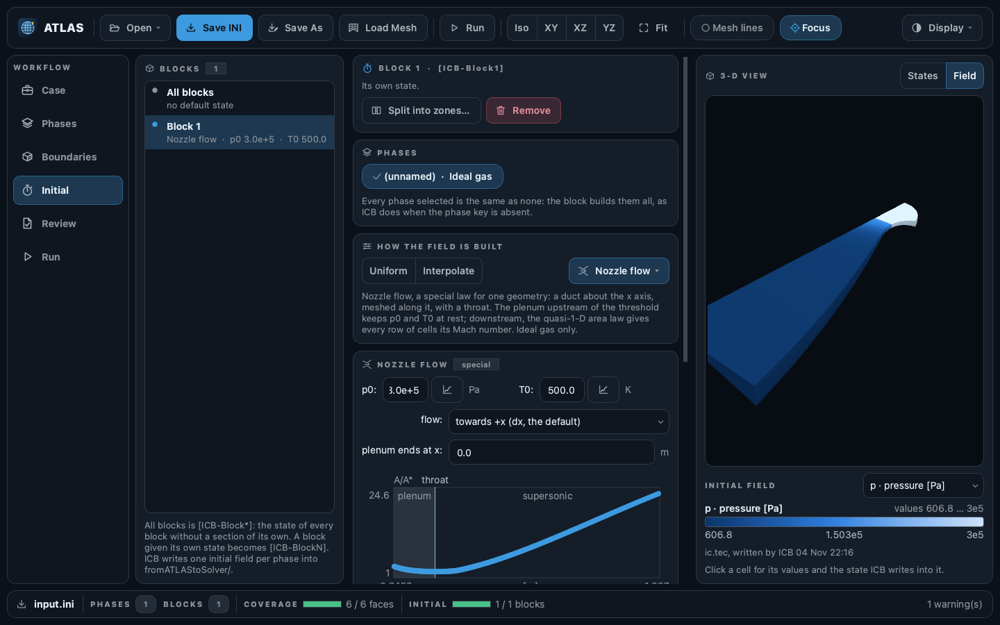

HYDRA CFD SUITE

<h1 class="atlas-hero__title">ATLAS</h1>

Open-source pre-processing tools for multi-physics simulations. Generate thermodynamic and transport tables, boundary conditions and initial fields for the Hydra solvers.

$ ATLAS GPB BCB ICB

[Get started](getting-started/index.md){ .md-button .md-button--primary }
[Tutorials](tutorials/index.md){ .md-button .atlas-hero__ghost }

<strong>A</strong>uxiliary <strong>T</strong>oolbox and <strong>L</strong>ibraries for
Hydr<strong>A</strong> <strong>S</strong>olvers

The toolbox

## Everything you need before solver runtime { .atlas-heading }

Set the case up in the [GUI](user-guide/gui.md) from the mesh alone: it writes the
setup of every tool and runs them. The same tools run from the shell.

[:material-flask-outline: <b>Phase building</b> <i>Define gas, liquid, and solid phases with consistent property models.</i>](user-guide/gpb/index.md){ .atlas-tool }
[:material-cube-outline: <b>Boundary conditions</b> <i>Configure inlets, outlets, walls, and multi-patch boundaries for complex simulation domains.</i>](user-guide/bcb/index.md){ .atlas-tool }
[:material-gradient-horizontal: <b>Fields initialization</b> <i>Initialize every sort of fields using constants, profiles, or interpolation procedures.</i>](user-guide/icb/index.md){ .atlas-tool }
[:material-database-outline: <b>Data libraries</b> <i>Standardize and customize thermodynamic and transport databases for application-specific modeling.</i>](databases/index.md){ .atlas-tool }
[:material-view-split-vertical: <b>Mesh decomposition</b> <i>Split multi-block meshes for optimal MPI load balance.</i>](user-guide/mdb/index.md){ .atlas-tool }
[:material-chart-bell-curve-cumulative: <b>Kinetic engines</b> <i>Load, validate, and inspect reaction mechanisms with dedicated thermo-chemical analysis tools.</i>](user-guide/kant/index.md){ .atlas-tool }

## Hydra CFD Suite { .atlas-heading }

Hydra couples solvers of gases, real fluids, solids, particles and radiation in one
simulation. ATLAS writes the files each of them reads.

Your case

:material-grid: structured mesh

:material-database: [databases](databases/index.md)

ATLAS

[GPB](user-guide/gpb/index.md) [BCB](user-guide/bcb/index.md) [ICB](user-guide/icb/index.md) [STB](user-guide/stb/index.md) [MDB](user-guide/mdb/index.md) [KAnT](user-guide/kant/index.md)

input files for each run

[Hydra](https://github.com/open-hydra) · the coupled simulation

[<b>MOSE</b> compressible flow <i>ideal-gas</i>](https://github.com/open-hydra/MOSE){ .hydra__solver .hydra__solver--gas }
[<b>GROOT</b> radiative transfer <i>no ATLAS phase</i>](https://github.com/open-hydra/GROOT){ .hydra__solver .hydra__solver--radiation }
[<b>ARES</b> real-fluid flow <i>real-fluid</i>](https://github.com/open-hydra/ARES){ .hydra__solver .hydra__solver--fluid }
[<b>FUSS</b> heat conduction in solids <i>solid</i>](https://github.com/open-hydra/FUSS){ .hydra__solver .hydra__solver--solid }
[<b>IGLOO</b> Lagrangian particles <i>dispersed</i>](https://github.com/open-hydra/IGLOO){ .hydra__solver .hydra__solver--particle }
[<b>ICE</b> Eulerian particles <i>dispersed</i>](https://github.com/open-hydra/ICE){ .hydra__solver .hydra__solver--particle }

Built on

[<b>ORION</b> Tecplot, VTK and PLOT3D I/O](https://MarcoGrossi92.github.io/ORION/){ .hydra__lib }
[<b>FLINT</b> thermochemistry](https://MarcoGrossi92.github.io/FLINT/){ .hydra__lib }
[<b>OSLO</b> ODE integrators](https://github.com/MarcoGrossi92/OSLO){ .hydra__lib }
[<b>FiNeR</b> INI file parser](https://github.com/szaghi/FiNeR){ .hydra__lib }

[Quick Start](getting-started/quick-start.md)
[User Guide](user-guide/index.md)
[ATLAS GUI](user-guide/gui.md)
[Tutorials](tutorials/index.md)
[Databases](databases/index.md)
[Developer Guide](development/index.md)

