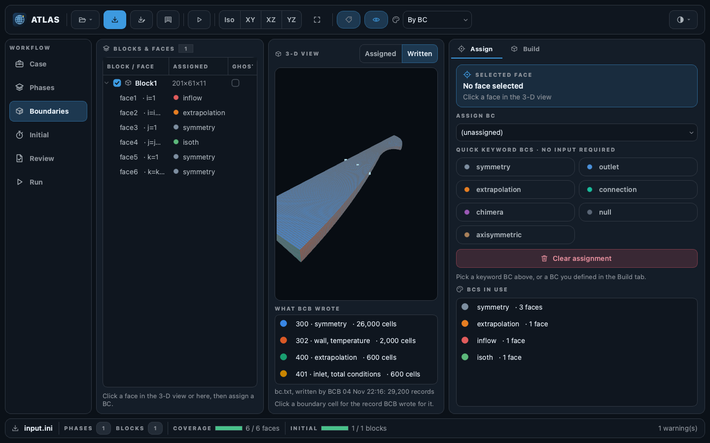

# BCB — Boundary Condition Builder

BCB assigns boundary conditions to block faces and writes solver-ready BC files.

It supports simple single-patch boundaries, multipatch definitions, periodic links, standard block connections, and chimera/overset connectivity workflows.

!!! tip "BCB in the Hydra workflow"
    BCB is designed to be used in the Hydra workflow. It consumes mesh and phase information built by other tools, and produces BC files for use by all Hydra solvers.

!!! example "Prefer a visual workflow?"
    The interactive [BCB GUI](./gui.md) lets you load a mesh, click block faces,
    assign boundary conditions, and export the `input.ini` directly. Launch it
    with `ATLAS GUI`.

    [](./gui.md)

---

## BC Types

<div class="grid cards" markdown>

-   :material-arrow-right-bold: **Inlet / Outlet**

    ---

    Total conditions, mass flux, supersonic, back-pressure, normal velocity, time series and injector nozzles,
    for gas and dispersed phases.

    [:octicons-arrow-right-24: Inlet](bc-types.md#inlet), [outlet](bc-types.md#outlet)

-   :material-wall: **Wall**

    ---

    Heat flux or temperature, uniform or from a table; convective and radiative forms on a solid.

    [:octicons-arrow-right-24: Wall](bc-types.md#wall)

-   :material-fire-circle: **Gas-Surface Interaction**

    ---

    `gsi`: solid-propellant burning, melting, pyrolysis and surface reactions, selected from the keys of the
    section; `manifold` draws its state from another face.

    [:octicons-arrow-right-24: gsi](bc-types.md#gsi), [manifold](bc-types.md#manifold)

-   :material-link-variant: **Connection / Periodic**

    ---

    Face-to-face coupling between blocks, found by matching face centres, and periodic pairs.

    [:octicons-arrow-right-24: Block Connectivity](connectivity.md)

-   :material-vector-intersection: **Chimera**

    ---

    Overset-grid connectivity with donor/receiver interpolation payloads.

    [:octicons-arrow-right-24: Requirements and limits](connectivity.md#chimera)

-   :material-link-lock: **Multi-solver**

    ---

    Connection and chimera records between the phases of a coupled case (`103`, `104`), for the multi-solver
    runs of Hydra.

    [:octicons-arrow-right-24: Output IDs](output.md#103-multi-solver-connection)

</div>

Use the full reference in [BC Types](./bc-types.md) for summary tables and INI syntax examples for each type.

## Workflow

1. Provide the [required files](required-files.md): the mesh, and the phase files GPB wrote into `fromATLAStoSolver/`.
2. In the INI file (`input.ini` by default), define a `[BCB-BlockN]` section for each block of the mesh and map
   `face1` … `face6` to BC names.
3. Define each BC section that takes parameters (inlet, wall, periodic pair, ...).
4. Run BCB; the BC files are written into `fromATLAStoSolver/`.

```bash
ATLAS BCB --input input.ini
```

## References

- [Required files](./required-files.md)
- [BC Setup](./bc-setup.md)
- [BCB GUI](./gui.md)
- [BC Types](./bc-types.md)
- [Output Files](./output.md)
- [Input Reference](./input-reference.md)

See the [BCB tutorials](../../tutorials/bcb/index.md) for worked examples, and [Testing](../../development/testing.md#bcb-cases-testbcb) for the test cases.

## Next

- [BC Setup](./bc-setup.md)